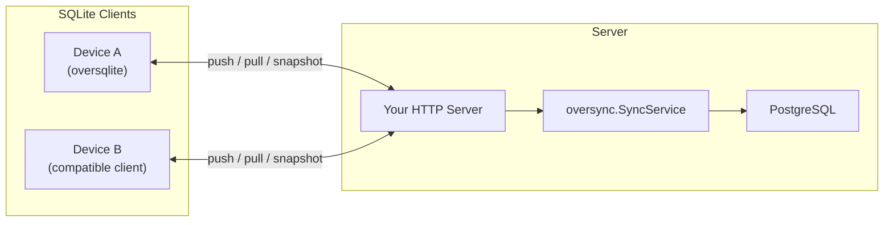

# Multi-Device Synchronization Architecture

go-oversync implements a bundle-based replication model for SQLite clients and PostgreSQL servers.
This page describes the architecture implemented by the current repository.

## Overview

The current architecture has four main pieces:

- your application HTTP server
- `oversync.SyncService` on PostgreSQL
- `oversqlite.Client` on SQLite
- the bundle/snapshot HTTP protocol between them

## How It Works

1. Your server registers the PostgreSQL tables that participate in sync.
2. `Bootstrap()` validates the server schema and prepares the sync metadata/runtime topology. A
   fresh layout atomically adopts populated registered tables; a committed existing layout attaches
   after declaration and managed-definition validation without scanning business or operational
   sync rows.
3. The SQLite client runs `Open()` on launch, then `Attach(userID)` after sign-in.
4. The SQLite client tracks local writes in `_sync_dirty_rows` with triggers.
   After `Detach()`, those triggers stay active so offline anonymous writes continue to enqueue
   local dirty state immediately.
5. `PushPending()` freezes those writes into `_sync_outbox_*`, sends exactly one bounded
   `/sync/push` request, then atomically applies the authoritative response bundle. Process restart
   keeps that singleton outbox durable and replays the same tuple instead of recollecting a new
   local bundle.
6. `PullToStable()` reads complete committed bundles from `/sync/pull` and advances the local
   checkpoint only after durable local apply.
7. `Rebuild(ctx)` rebuilds managed tables from `/sync/snapshot-sessions` when a client is new or
   falls behind retained history. For stale/out-of-order source recovery, `oversqlite` chooses the
   rebuild-plus-rotate path internally. The server materializes those frozen snapshots inside
   PostgreSQL session tables and serves chunk reads statelessly by `snapshot_id`. During rotated
   recovery the client persists one replacement source id durably, the server reserves that
   replacement source explicitly, and the old source is retired fail-closed until rebuild finishes.

## Authoritative State

PostgreSQL business tables are authoritative. Sync metadata is derived from committed
business-table effects and stored under the `sync` schema.

Important runtime tables include:

- `sync.meta`
- `sync.table_catalog`
- `sync.user_state`
- `sync.scope_state`
- `sync.source_state`
- `sync.row_state`
- `sync.bundle_log`
- `sync.bundle_rows`
- `sync.scope_write_receipts`
- `sync.server_source_reservations`
- `sync.snapshot_sessions`
- `sync.snapshot_session_rows`

The server uses compact internal identities in hot sync tables: `user_pk` for users, `table_id`
for registered tables, `key_bytes` for row keys, and `op_code` for operations. Visible protocol
fields such as `schema`, `table`, `key`, `op`, `row_version`, and payload JSON are reconstructed
at the HTTP boundary.

`sync.bundle_log` is the durable committed-bundle metadata and accepted-push replay source. Bundle
history is retained only above each user's `retained_bundle_floor`; below that floor, clients
recover through snapshot rebuild rather than best-effort historical replay.

## Bootstrap Trust Boundary

Fresh layout creation and populated-table adoption are one fail-closed PostgreSQL transaction with
exact post-persistence validation. After that transaction commits, restart attachment trusts
PostgreSQL's durable row state and validates only registered declarations plus the exact managed
definition. It does not scan, rewrite, backfill, hash, reconcile, or repair business or operational
sync rows.

Registered-table guards still reject ordinary direct DML without a bundle context and reject every
`TRUNCATE`. Privileged trigger bypass and direct managed-row edits are outside the supported trust
boundary; Bootstrap does not detect or repair them.

## Server-Originated Writes

If your application writes registered PostgreSQL tables outside client push handling, it should do
so through `ScopeManager.ExecWrite(...)` in the common case, or `WithinSyncBundle(...)` if your
application needs the lower-level primitive directly. Both paths ensure the committed business
transaction is captured as one sync bundle visible to other clients. See
[Server-Originated Writes]({{ site.baseurl }}/documentation/server-originated-writes/) for the
retryable database-only callback contract, durable operation identity, commit-ambiguity handling,
and examples.

## Core Concepts

### [Core Concepts →]({{ site.baseurl }}/documentation/core-concepts/)

Read the core concepts page for the exact vocabulary used by the current contract.
# Schema-generation sessions

The service is constructed with one or two complete `SchemaGenerations` declarations and joins
each compiled immutable contract to the registered-table catalog and live PostgreSQL metadata at
Bootstrap. There is no `MaxSupportedSchemaVersion` fallback. Fresh generation databases include
`sync.source_generation_bindings`, generation-bound push and snapshot sessions, and
`sync.bundle_log.planned_row_count`; pre-generation managed layouts fail closed instead of being
automatically migrated.

Connect permanently binds a client `(user, source)` to an exact generation ID/fingerprint pair.
Admission uses the indexed per-user source limit; retained active, reserved, and retired bindings
remain protocol witnesses. Push and snapshot sessions pin that pair. The Q39 client request hash
includes the generation proof and the exact ordered physical request rows. Its durable
`planned_row_count` is distinct from `bundle_log.row_count`, which describes canonical server
effects after transitions and cascades. In other words, request identity covers supplied rows while
bundle identity covers canonical server effects.

All generations read the same immutable `sync.bundle_log` / `sync.bundle_rows` history. The runtime
validates each canonical bundle and derives a deterministic generation-visible stream on demand,
preserving canonical order while removing hidden tables and columns. Projected counts, byte counts,
and hashes describe that visible stream. No projection metadata cache or per-generation durable
copy exists. Empty visible streams remain pull envelopes so checkpoints can cross invisible-only
canonical commits.

Push commit validates, inside the business transaction, that every uploaded key produced a final
captured effect visible to the pinned generation. Missing coverage rolls back business, trigger,
cascade, audit, and source-progress changes together. Normalized and additional effects are valid;
the client settles them without comparing effect payloads to original intent and preserves newer
local edits.
